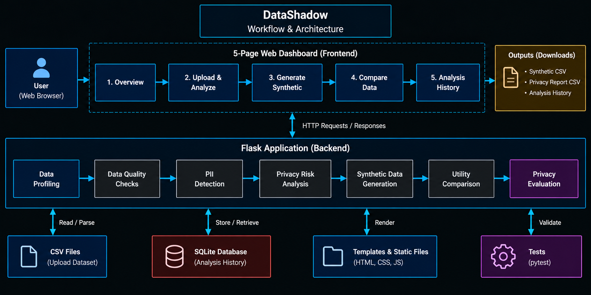
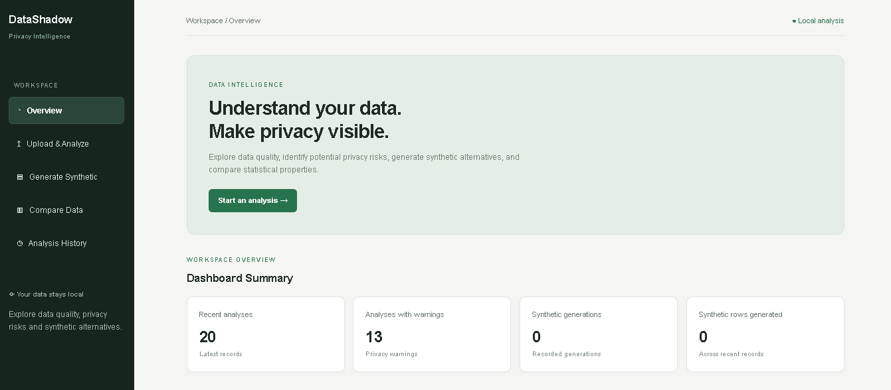
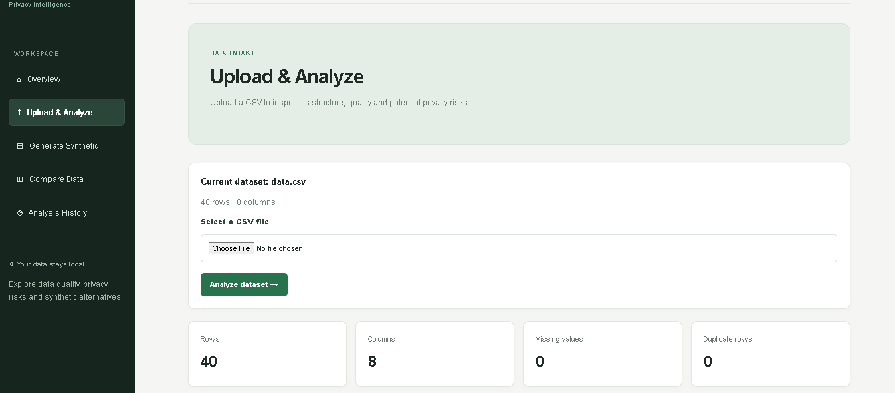
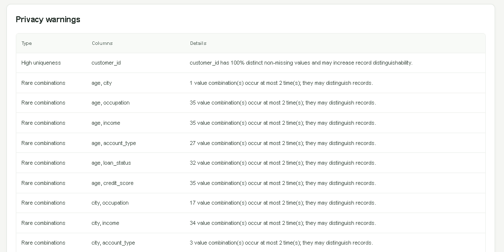
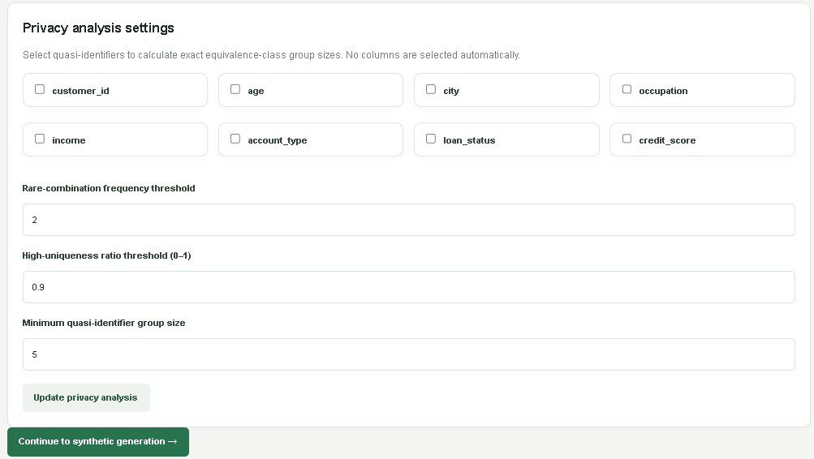
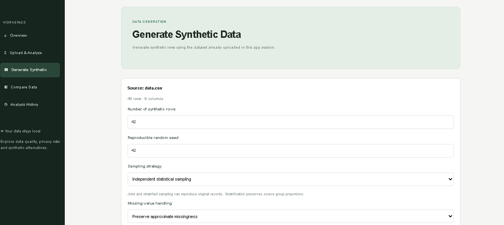
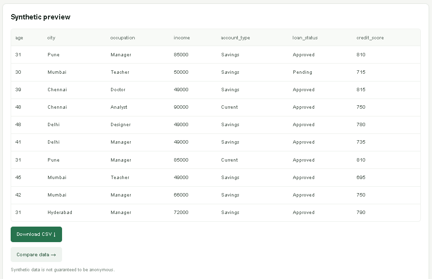
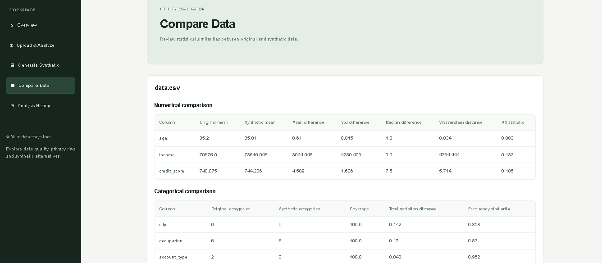
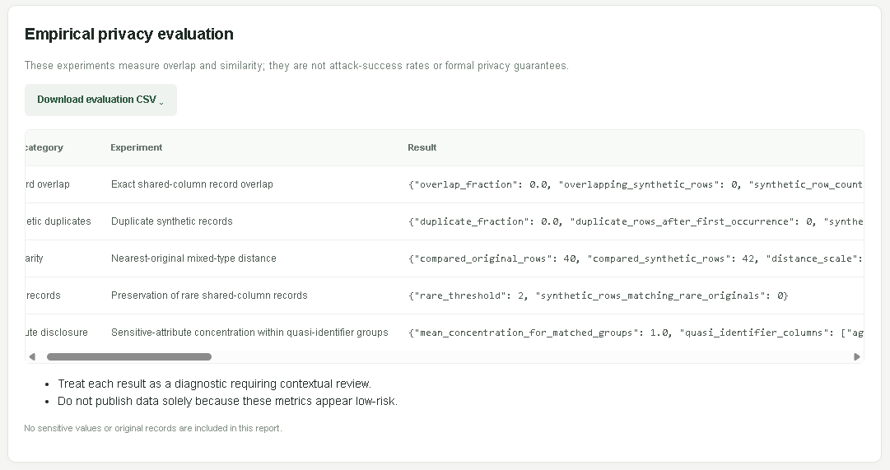
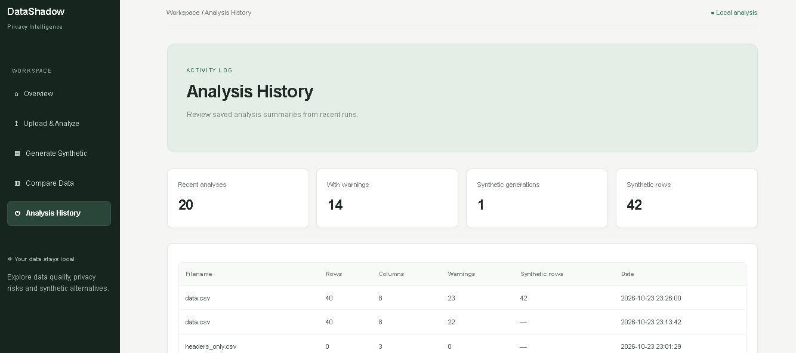

# DataShadow

**Analyze privacy risks. Generate synthetic alternatives.**

DataShadow is a lightweight, local Flask application for profiling CSV datasets, identifying potential privacy risks, generating synthetic alternatives, and comparing statistical utility.

It brings data profiling, data quality checks, heuristic privacy analysis, configurable synthetic-data generation, and empirical privacy evaluation into one dashboard. It is designed for local exploratory analysis without external APIs or heavyweight machine-learning models.

## Features

### Phase 1 — Core Workflow

- **CSV Upload and Validation:** Validate CSV files with a 5 MB file-size limit, 10,000-row limit, 100-column limit, and CSV-only restrictions.
- **Dataset Profiling:** Inspect dataset dimensions, column types, missing values, distinct values, and numerical summaries.
- **Potential PII Detection:** Identify possible personal or identifying information using rule-based indicators.
- **Data Quality Analysis:** Detect duplicate rows, missing values, and constant columns.
- **Privacy-Risk Warnings:** Highlight high uniqueness and rare combinations that may increase record distinguishability.
- **Analysis History:** Store analysis summaries in SQLite without persisting original source rows.
- **Safe CSV Export:** Apply spreadsheet formula-injection mitigation and validate one-time download tokens.
- **Dashboard:** Navigate Overview, Upload & Analyze, Generate Synthetic, Compare Data, and Analysis History.

### Phase 2 — Advanced Statistical Analysis

- Numerical comparisons covering mean, standard deviation, median, quartiles, Wasserstein distance, and the Kolmogorov–Smirnov statistic.
- Numerical correlation-matrix comparison when sufficient usable numerical columns exist.
- Categorical category coverage, frequency distributions, total variation distance, and frequency similarity.
- Separate missingness comparisons and appropriate handling of constant columns and small samples.
- Configurable uniqueness, rare-combination, and minimum quasi-identifier group-size thresholds.
- Exact equivalence-class size analysis for selected quasi-identifiers.
- Server-side validation of generation settings, random seeds, missing-value policies, and optional column constraints.

### Phase 3 — Synthetic Data and Privacy Evaluation

- **Independent Statistical Sampling:** Generate values independently by column using empirical resampling or a normal model for numerical data, and weighted or uniform sampling for categorical data.
- **Joint Complete-Row Resampling:** Resample complete source rows to retain observed cross-column relationships.
- **Stratified Complete-Row Resampling:** Sample within selected groups while allocating rows according to source group proportions.
- **Missing-Value Handling:** Preserve approximate missingness, impute numerical medians or categorical modes, or use complete source rows.
- **Column Constraints:** Configure supported numerical ranges and allowed categorical values.
- **Record-Overlap Analysis:** Measure exact overlap between source and generated records on shared columns.
- **Duplicate Detection:** Identify repeated synthetic records.
- **Nearest-Original Similarity:** Evaluate mixed-type distances between sampled original and synthetic records.
- **Rare-Record Analysis:** Assess the preservation of infrequent source records.
- **Aggregate Disclosure Analysis:** Examine sensitive-attribute concentration within selected quasi-identifier groups.
- **Consolidated Evaluation:** Present privacy diagnostics, statistical utility metrics, and explanatory limitations.
- **Report Export:** Download empirical privacy-evaluation results as CSV.


## Workflow Architecture

The following diagram illustrates the end-to-end workflow and architecture of DataShadow, from dataset upload and analysis to synthetic data generation, evaluation, and report generation.



### Workflow Overview

1. **User & Dashboard:** Access the five dashboard sections — Overview, Upload & Analyze, Generate Synthetic, Compare Data, and Analysis History.
2. **Flask Backend:** Handles application requests, validation, session management, and workflow execution.
3. **Data Processing:** Performs data profiling, quality checks, PII detection, and privacy risk analysis.
4. **Synthetic Data Generation:** Generates synthetic datasets using configurable sampling strategies and constraints.
5. **Evaluation:** Compares original and synthetic datasets using utility metrics and empirical privacy evaluation.
6. **Storage & Outputs:** Maintains analysis history in SQLite and provides synthetic CSV files and privacy reports for download.

### Supporting Components

- **CSV Files:** Source dataset uploads.
- **In-Memory Store:** Temporary dataset and session storage.
- **SQLite Database:** Stores analysis history and summary metadata.
- **Templates & Static Files:** Provides the web interface.
- **Automated Tests:** Validates application functionality and security.


## Dashboard Screenshots

The following screenshots demonstrate the DataShadow interface and its analysis workflow.

### 1. Dashboard Overview

The overview page summarizes recent analyses, privacy warnings, and synthetic-data generation activity.



### 2. Upload and Analyze

Upload a CSV dataset and inspect its structure, data quality, and potential privacy risks.



### 3. Privacy Warnings

Review potential identifiers, high uniqueness, and rare combinations that may increase record distinguishability.



### 4. Privacy Analysis Settings

Configure quasi-identifiers and thresholds for privacy-risk analysis.



### 5. Synthetic Data Generation

Configure the synthetic row count, reproducible random seed, sampling strategy, missing-value handling, and supported sampling options.



### 6. Synthetic Data Preview and Download

Inspect generated records and access the synthetic CSV download option.



### 7. Statistical Utility Comparison

Compare numerical statistics and categorical distributions between the original and synthetic datasets.



### 8. Empirical Privacy Evaluation

Review record overlap, synthetic duplicates, nearest-original distances, rare-record preservation, and aggregate disclosure diagnostics.



### 9. Analysis History

Review saved analysis summaries, warning counts, and synthetic-generation activity.



## Technology Stack

| Technology | Purpose |
|---|---|
| Python | Application logic and analysis |
| Flask | Web application and routing |
| Pandas | CSV processing and data analysis |
| NumPy | Numerical operations and statistical sampling |
| HTML | Dashboard structure |
| CSS | Dashboard styling and responsive layout |
| JavaScript | Frontend interactions |
| SQLite | Persistent analysis history |
| pytest | Automated testing |

## Architecture

| Module | Responsibility |
|---|---|
| `app.py` | Flask routes, validation, workflow management, and downloads |
| `profiler.py` | Dataset dimensions, column types, missingness, uniqueness, and numerical summaries |
| `data_quality.py` | Duplicate-row, missing-value, and constant-column findings |
| `pii_detector.py` | Rule-based potential identifier detection |
| `privacy_analyzer.py` | Uniqueness, rare combinations, and quasi-identifier group-size analysis |
| `synthetic_generator.py` | Independent, joint, and stratified sampling strategies |
| `utility_evaluator.py` | Numerical and categorical utility comparisons |
| `privacy_evaluator.py` | Empirical record-overlap, duplicate, distance, rare-record, and aggregate disclosure experiments |
| `history_db.py` | SQLite analysis-history storage and queries |
| `dataset_store.py` | In-memory active-dataset storage and expiration helper |
| `templates/index.html` | Dashboard pages and forms |
| `static/style.css` | Dashboard styling and responsive layout |

### Data Handling

The active dataset and generated results are held in application memory and expire after 30 minutes of inactivity. Restarting the application clears active in-memory data.

SQLite stores analysis summary metadata separately from the active dataset. Uploaded source rows and generated datasets are not intentionally persisted in the analysis-history database.

## Installation and Setup

### Prerequisites

- Python 3.10 or later
- pip
- Git (optional)

### 1. Clone the repository

```powershell
git clone git@github-personal:karthik-k11/DataShadow.git
cd DataShadow
```

### 2. Create and activate a virtual environment

```powershell
python -m venv .venv
.venv\Scripts\Activate.ps1
```

### 3. Install dependencies

```powershell
pip install -r requirements.txt
```

### 4. Start the application

```powershell
python app.py
```

Open the local address displayed in the terminal, normally:

```text
http://127.0.0.1:5000
```

The Flask debug reloader is disabled to avoid leaving a child server process
running after its terminal closes. Stop the server with `Ctrl+C` before closing
the terminal.

### 5. Use the application

1. Open **Upload & Analyze** and upload a CSV file.
2. Review the dataset profile, quality findings, and privacy warnings.
3. Configure privacy-analysis settings if required.
4. Navigate to **Generate Synthetic** without uploading the file again.
5. Choose a generation strategy and configure supported options.
6. Generate and preview the synthetic dataset.
7. Open **Compare Data** to inspect statistical utility.
8. Review empirical privacy-evaluation results and export available reports.
9. Open **Analysis History** to review saved analysis summaries.

## Running Tests

Run the complete automated test suite from the project directory:

```powershell
pytest -q
```

The reported Phase 2 and Phase 3 implementation completed with **110 passing tests**. Tests cover utility metrics, synthetic generation strategies, constraints, privacy calculations, application workflows, and export security.

Run the test suite again after making changes to verify the current state of your local working tree.

## Utility Metric Interpretation

DataShadow reports descriptive metrics to help evaluate how closely synthetic data resembles the original dataset.

- **Mean, standard deviation, median, and quartile differences:** Absolute differences in the original column's units. Smaller differences indicate closer summary statistics.
- **Wasserstein distance:** Measures distribution displacement using empirical distributions. Smaller values generally indicate greater similarity.
- **Kolmogorov–Smirnov statistic:** Measures the maximum absolute difference between two empirical cumulative distributions. It ranges from 0 to 1.
- **Category coverage:** Measures the fraction of original observed categories represented in synthetic output.
- **Total variation distance:** Measures categorical frequency-distribution differences. It ranges from 0 to 1, with lower values indicating greater similarity.
- **Frequency similarity:** Defined as one minus total variation distance.
- **Missingness comparison:** Evaluates missing-value proportions separately from value-distribution metrics.
- **Correlation difference:** Measures the mean absolute difference between usable pairwise Pearson correlation matrices.

Metrics measured in different units should not be compared directly. Small datasets may produce unstable or misleading comparisons, and descriptive similarity does not guarantee that synthetic data will perform equally well in downstream applications.

## Privacy Evaluation Methodology and Limitations

DataShadow combines heuristic analysis with empirical experiments to help identify potential privacy risks.

### Quasi-Identifier Analysis

Selected quasi-identifiers are used to calculate equivalence-class group sizes. High uniqueness, rare combinations, and small groups can indicate increased record distinguishability.

A minimum-group-size check is a k-anonymity-style diagnostic for the selected fields only. Meeting a group-size threshold does not prevent all linkage attacks, background-knowledge attacks, or sensitive-attribute disclosure.

### Empirical Privacy Experiments

The privacy evaluator includes:

- Exact shared-column record-overlap analysis.
- Duplicate synthetic-record detection.
- Nearest-original mixed-type distance analysis.
- Rare-record preservation checks.
- Optional aggregate sensitive-attribute concentration analysis.

Nearest-original distance is a mixed-type diagnostic that scales numerical differences, compares categorical values, and accounts for missingness. The implementation uses deterministic subsamples capped at 500 rows per dataset.

These experiments measure overlap, similarity, and aggregate patterns. They do not establish an attacker's actual success rate.

### Limitations

- Membership-inference testing is not implemented because the application does not define a target model and attacker evaluation protocol.
- No differential privacy mechanism or formal privacy accounting is implemented.
- Joint and stratified resampling can reproduce original records exactly.
- Independent sampling can lose cross-column relationships.
- Stratification may preserve rare groups and source records.
- Similarity metrics and heuristic risk labels are not calibrated probabilities.
- Statistical similarity and synthetic generation do not guarantee anonymity or safe publication.

## Privacy and Security Notice

DataShadow is designed for local exploratory analysis, not as a hardened public service.

- Upload only datasets you are authorized to process.
- Do not expose the application to untrusted users without reviewing authentication, access controls, session configuration, and deployment security.
- CSV export applies formula-injection mitigation to text values beginning with spreadsheet formula characters.
- Synthetic-data and privacy-report downloads use one-time in-memory tokens with expiration.
- Analysis history stores summary metadata rather than original source rows.
- Privacy findings should be reviewed in the context of the dataset, intended use, and applicable legal and organizational requirements.

**Synthetic data is not automatically anonymous.** Evaluate its residual privacy risks before sharing or publishing it.

## Development Roadmap

### Phase 1 — Core Workflow

- CSV upload and validation.
- Dataset profiling and data-quality checks.
- Potential PII detection and privacy warnings.
- Synthetic-data generation and utility comparison.
- Safe CSV export and analysis history.

### Phase 2 — Advanced Analysis

- Expanded statistical utility metrics.
- Configurable privacy-risk thresholds.
- Quasi-identifier group-size analysis.
- Generation settings and constraints.
- Improved metric interpretation.

### Phase 3 — Privacy Evaluation

- Multiple synthetic-data sampling strategies.
- Record-overlap and duplicate analysis.
- Nearest-original similarity diagnostics.
- Rare-record and aggregate disclosure experiments.
- Consolidated privacy–utility reporting.
---